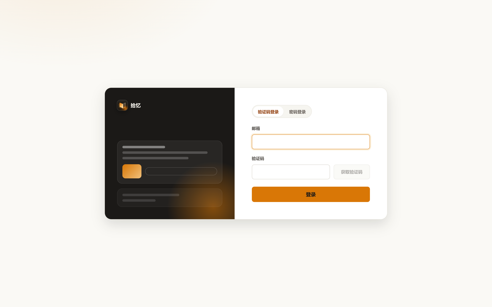
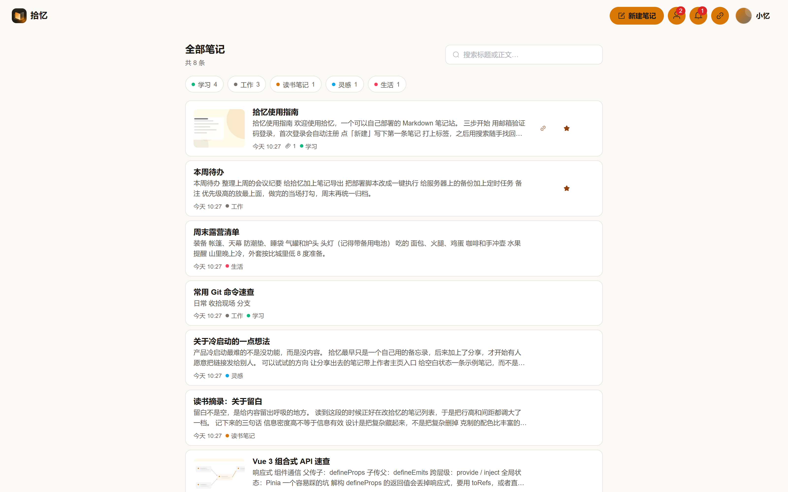
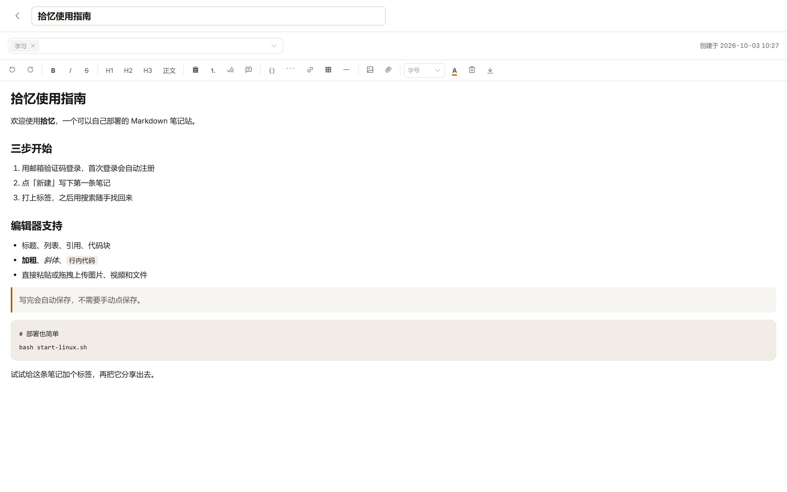
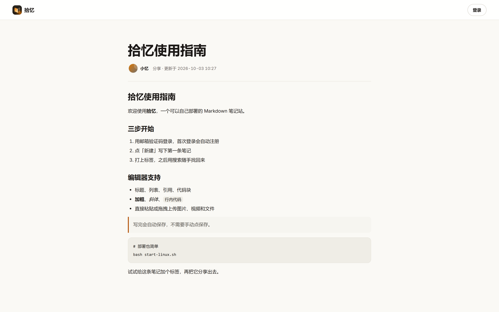
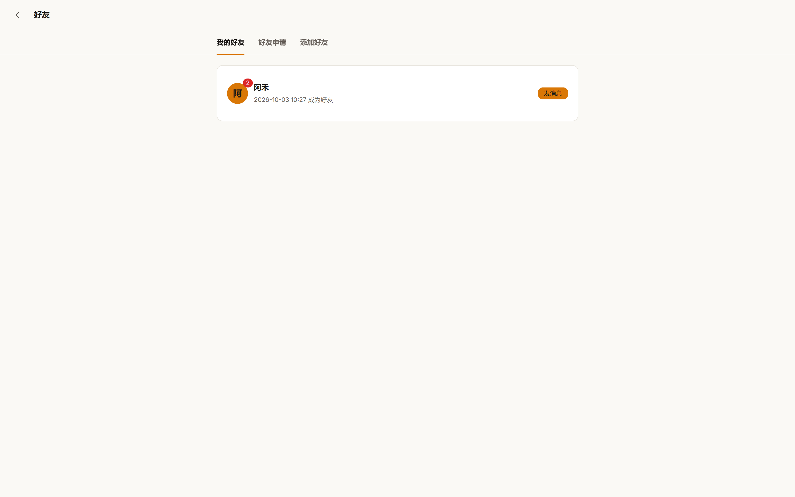
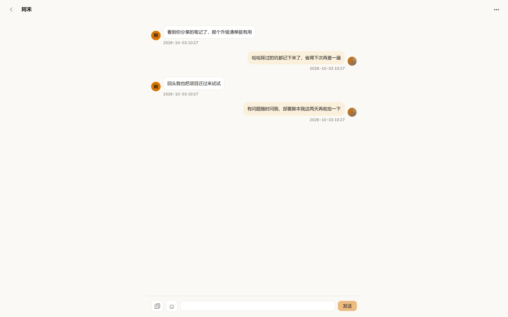
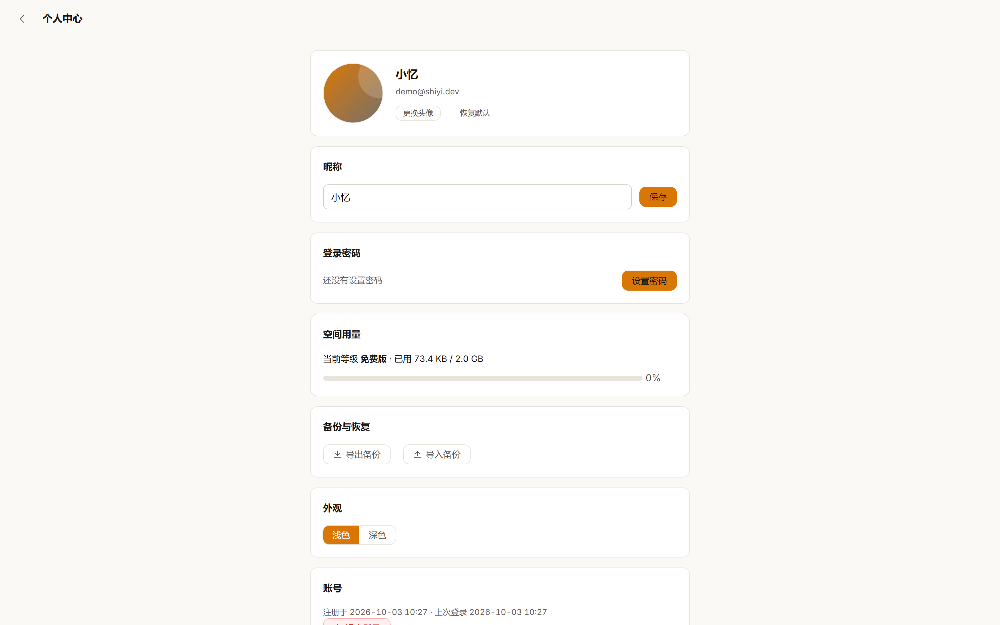
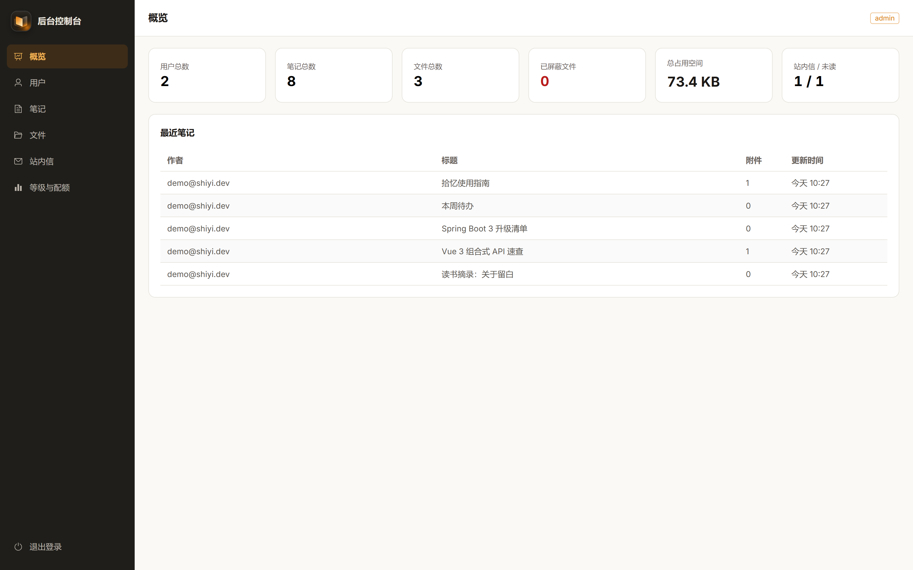

<div align="center">


# 拾忆 · Shiyi Memo

**自托管的个人笔记站**

拾起零散记录，收好重要文件

[](LICENSE)
[](https://openjdk.org/)
[](https://spring.io/projects/spring-boot)
[](https://vuejs.org/)
[](https://www.mysql.com/)
[](#贡献)

</div>

---

## 简介

拾忆是一个可以完全自托管的个人笔记站：所见即所得地写笔记、打标签，用全文搜索随时找回来；图片、音视频和各类文件当作附件一起收进来，需要时生成一条公开链接分享给任何人。

前后端打包成单个可执行 jar，配一个 MySQL 就能跑起来；后台控制台独立于用户端，方便自己或小团队做多用户管理。

## 界面预览

| 登录 | 笔记列表 |
| --- | --- |
|  |  |

| 笔记详情 | 公开分享 |
| --- | --- |
|  |  |

| 好友列表 | 好友聊天 |
| --- | --- |
|  |  |

| 个人中心 | 后台控制台 |
| --- | --- |
|  |  |

## 功能特性

**笔记**

- 所见即所得富文本编辑：标题、列表、待办、引用、代码块、表格，字号 / 颜色 / 对齐 / 缩进随手调，图片、视频和附件可直接插入
- 标签、全文搜索、置顶与自动保存
- 单条笔记导出为 Markdown / HTML / Word / PDF / 长图
- 笔记可一键公开分享，随时开启或关闭

**文件**

- 图片、视频、音频和任意文件上传，图片自动生成缩略图
- 个人空间配额，按用户等级控制上传上限
- 附件在线预览、下载，后台可对文件做封禁处理

**社交**

- 邮箱验证码登录，首次登录自动注册，也可设置登录密码
- 好友关系与申请、站内信、基于 SSE 的实时聊天
- 聊天支持发送图片与文件：图片气泡预览，文件卡片在线预览、下载
- 聊天记录搜索、清空会话、单向删除好友

**个人中心与后台**

- 个人资料、头像、深浅主题、空间用量查看
- 个人数据一键打包备份 / 恢复（zip：笔记 + 标签 + 附件）
- 独立后台控制台：用户、笔记、文件、消息、用户等级管理

## 技术栈

| 层次 | 技术 |
| --- | --- |
| 后端 | Java 21 · Spring Boot 3.5 · MyBatis-Plus · Flyway · JJWT |
| 前端 | Vue 3 · Vite · TypeScript · Element Plus · Pinia · Vue Router |
| 数据库 | MySQL 8 |
| 桌面端 | Electron（Windows 外壳，可选） |
| 部署 | 前端产物内嵌进 jar，PM2 守护进程 |

## 项目结构

```text
shiyi-memo/
├─ src/main/java/org/shiyi/memo/      后端源码（auth / memo / file / friend ... 分模块）
├─ src/main/resources/
│  ├─ application.yml                 默认配置
│  ├─ application-local.yml.example   本地配置模板
│  ├─ db/migration/                   Flyway 数据库迁移脚本
│  └─ static/                         前端构建产物（npm run build 生成）
├─ frontend/                          Vue 3 前端（前台 + 后台两个入口）
├─ desktop/                           Electron 桌面端（见 desktop/README.md）
├─ design-system/                     设计系统与视觉规范
├─ start/                             可执行 jar 与线上配置（构建产物）
├─ ecosystem.config.js                PM2 应用配置
├─ Dockerfile / docker-compose.yml   Docker 一键构建启动（.env.example 为配置模板）
├─ start-windows.ps1 / start-linux.sh 一键构建部署脚本
└─ dev.ps1                            本地开发启动脚本
```

## 快速开始

### 环境要求

- JDK 21
- Maven 3.9+
- Node.js 20+
- MySQL 8

### 1. 克隆仓库

```bash
git clone https://gitee.com/lieng618/shiyi-memo.git
cd shiyi-memo
```

> 装了 Docker 的话，可以跳过下面的环境安装和建库，直接看 [Docker 部署](#docker-部署)一条命令跑起来。

### 2. 创建数据库

```sql
CREATE DATABASE shiyi_memo
  DEFAULT CHARACTER SET utf8mb4 COLLATE utf8mb4_0900_ai_ci;
```

表结构由 Flyway 在首次启动时自动建好，无需手动执行 SQL。

### 3. 准备本地配置

复制模板并按需填写：

```bash
cp src/main/resources/application-local.yml.example src/main/resources/application-local.yml
```

至少填写数据库连接；需要邮箱验证码登录时，再补上 SMTP 账号与授权码。

### 4. 构建并启动

```bash
cd frontend && npm install && npm run build && cd ..
mvn -DskipTests package
java -jar start/shiyi-memo-1.0.0.jar
```

Windows 双击根目录的 `start-windows.bat`，或在终端执行：

```powershell
.\start-windows.ps1
```

启动后访问：

- 用户端：<http://localhost:8080>
- 后台控制台：<http://localhost:8080/admin>

## 配置说明

配置写在 `src/main/resources/application-local.yml`（线上为 `start/application-local.yml`）：

| 配置项 | 说明 |
| --- | --- |
| `spring.datasource.*` | MySQL 连接 |
| `spring.mail.*` | 验证码邮件 SMTP |
| `app.jwt.secret` | 登录令牌密钥，至少 32 字节，公网务必替换 |
| `app.jwt.secure-cookie` | 启用 HTTPS 后设为 `true` |
| `app.mail.enabled` | 是否真实发送邮件 |
| `app.mail.expose-code` | 本地联调时由接口返回验证码，线上必须为 `false` |
| `app.admin.username/password` | 后台控制台账号，与普通用户无关 |
| `app.storage.root` | 上传文件目录 |
| `app.storage.thumbnail-root` | 缩略图目录 |
| `app.security.allow-register` | 是否允许新邮箱自助注册 |

## 本地开发

```powershell
.\dev.ps1
```

脚本会同时拉起后端和前端：

- 后端：<http://localhost:8080>
- 前端：<http://localhost:5173>（已把 `/api` 代理到后端，支持热更新）

## 部署

`mvn package` 会把可执行 jar 输出到 `start/`，前端产物已经内嵌进 jar，PM2 的应用目录也指向这里：

```bash
bash start-linux.sh       # Linux 服务器：前端构建 → 后端打包 → PM2 启动 / 重启
start-windows.bat         # Windows：双击即可；装了 PM2 就走 PM2，否则直接 java -jar
```

线上配置 `start/application-local.yml` 与 jar 放在一起，由 PM2 通过 `--spring.config.additional-location` 加载；日志输出到 `start/logs/`。

> 公网部署前请务必：替换 `app.jwt.secret`、修改后台账号密码，并把 `app.mail.expose-code` 设为 `false`。

## Docker 部署

不用装 JDK / Maven / Node / MySQL，克隆仓库后一条命令完成构建和启动（首次构建会慢一些）：

```bash
docker compose up -d --build
```

- 用户端：<http://localhost:8080>
- 后台控制台：<http://localhost:8080/admin>（默认 `admin / change-me`，务必修改）

MySQL 数据存在 Docker 卷 `mysql-data` 里，表结构由 Flyway 自动创建；上传的文件和日志分别落在宿主机的 `./data` 与 `./logs`，和 jar 部署的目录结构一致。升级版本：`git pull && docker compose up -d --build`。

> Linux 上如果容器写 `./data` 报权限错误，执行 `sudo chown -R 1000:1000 data logs`（容器内应用固定以 UID 1000 运行）。

配置通过环境变量覆盖，把 [.env.example](.env.example) 复制成 `.env` 后按需修改（`.env` 不进仓库）：

| 变量 | 默认值 | 说明 |
| --- | --- | --- |
| `APP_PORT` | `8080` | 对外端口 |
| `MYSQL_PASSWORD` / `MYSQL_ROOT_PASSWORD` | 见 `.env.example` | 数据库密码 |
| `APP_JWT_SECRET` | 开发用默认值 | 登录令牌密钥，至少 32 字节，公网务必换成随机值 |
| `APP_JWT_SECURE_COOKIE` | `false` | 启用 HTTPS 后设为 `true` |
| `APP_ADMIN_USERNAME` / `APP_ADMIN_PASSWORD` | `admin` / `change-me` | 后台控制台账号 |
| `APP_BASE_URL` | `http://localhost:8080` | 站点对外地址，邮件链接会用它 |
| `APP_SECURITY_ALLOW_REGISTER` | `true` | 是否允许新邮箱自助注册 |
| `APP_MAIL_ENABLED` | `false` | 是否真实发送验证码邮件 |
| `APP_MAIL_EXPOSE_CODE` | `true` | 验证码由接口直接返回，仅限内网体验，公网必须设为 `false` |
| `SPRING_MAIL_HOST` / `SPRING_MAIL_PORT` | `smtp.qq.com` / `465` | SMTP 服务器 |
| `SPRING_MAIL_USERNAME` / `SPRING_MAIL_PASSWORD` | 空 | SMTP 账号与授权码 |
| `APP_MAIL_FROM` | 空 | 发件人地址 |

> 公网部署前请务必：替换 `APP_JWT_SECRET`、修改后台账号密码、配置 SMTP 并把 `APP_MAIL_EXPOSE_CODE` 设为 `false`。

## 数据与备份

服务端的数据分两块存放：

```text
data/
  uploads/       上传的原始文件
  thumbnails/    图片缩略图缓存
logs/            运行日志
```

- **元数据**（用户、笔记、标签、附件信息）在 MySQL 里
- **文件本体**在 `data/` 下

两者需要一起备份，只保存其中一个都恢复不完整。

用户也可以在个人中心自助备份：一键导出包含笔记、标签和附件的 zip 包，需要时再上传恢复，适合换服务器或迁移账号时使用。

## 桌面端

`desktop/` 是一个轻量 Electron 外壳，启动后加载站点地址，本身不含业务逻辑——前端改完部署到服务器，桌面端用户无需重新安装即可用上新版本。打包与服务器地址配置见 [desktop/README.md](desktop/README.md)。

## 贡献

欢迎提交 Issue 和 Pull Request。

1. Fork 本仓库，从 `main` 切出特性分支（建议 `feat/xxx`、`fix/xxx`）
2. 提交前本地跑通前端 `npm run build` 与后端 `mvn -DskipTests package`
3. 保持提交信息清晰，PR 描述里说明改动动机与验证方式

## 许可

本项目基于 [MIT License](LICENSE) 开源，Copyright (c) 2026 lieng。

## 致谢

感谢 Vue、Spring Boot、Element Plus、MyBatis-Plus、Flyway 等开源项目。

---

<div align="center">
<sub>如果拾忆对你有用，欢迎点一个 Star ⭐</sub>
</div>
